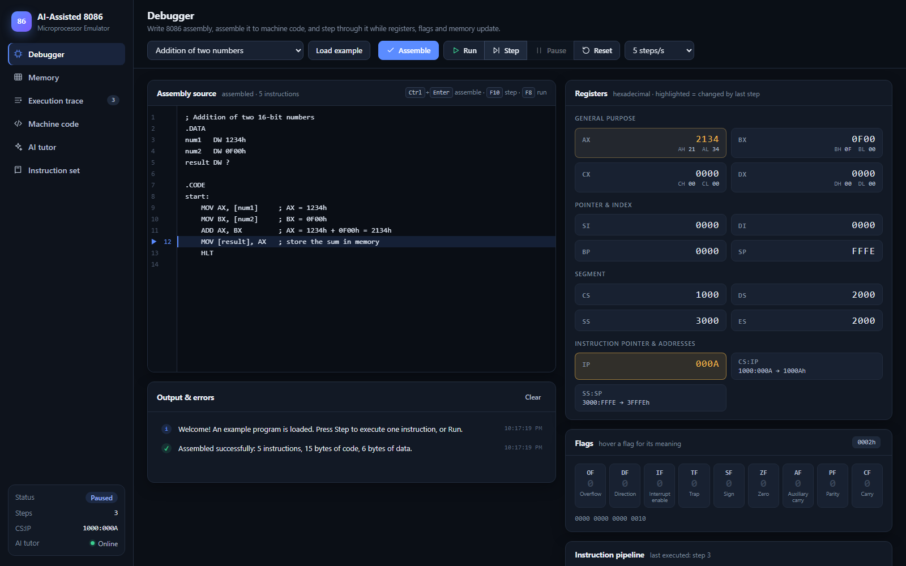
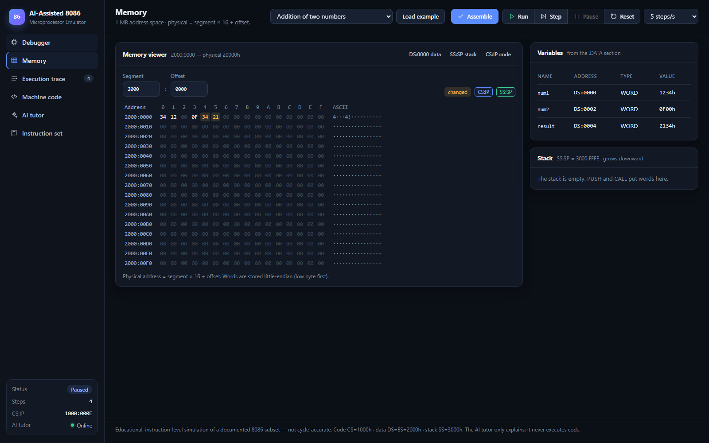
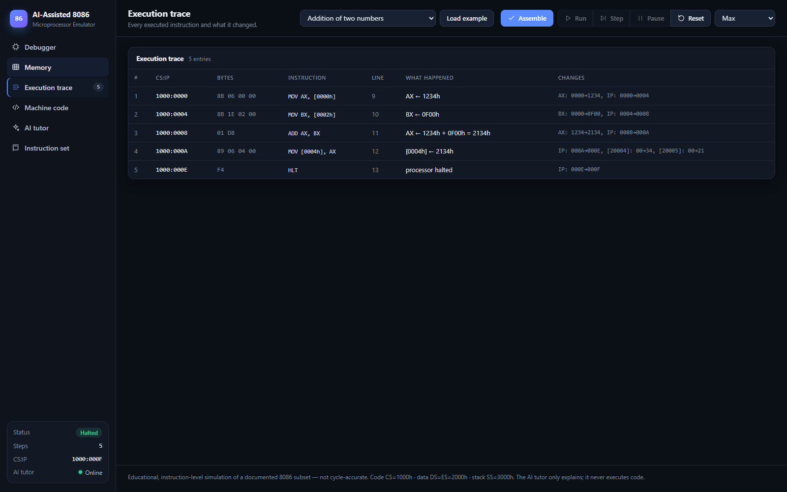
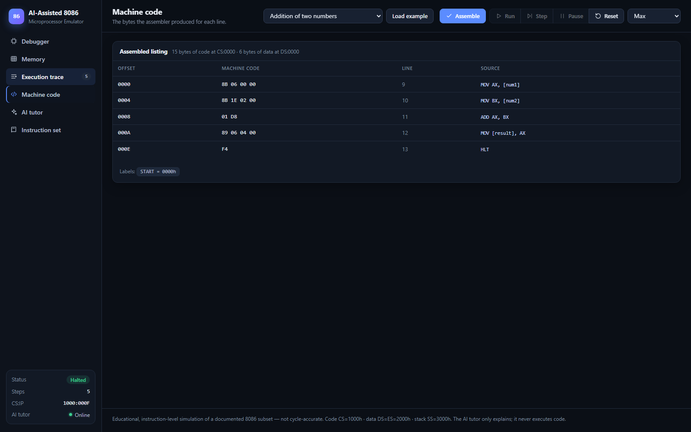
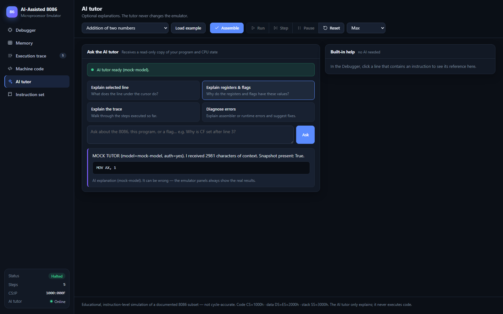
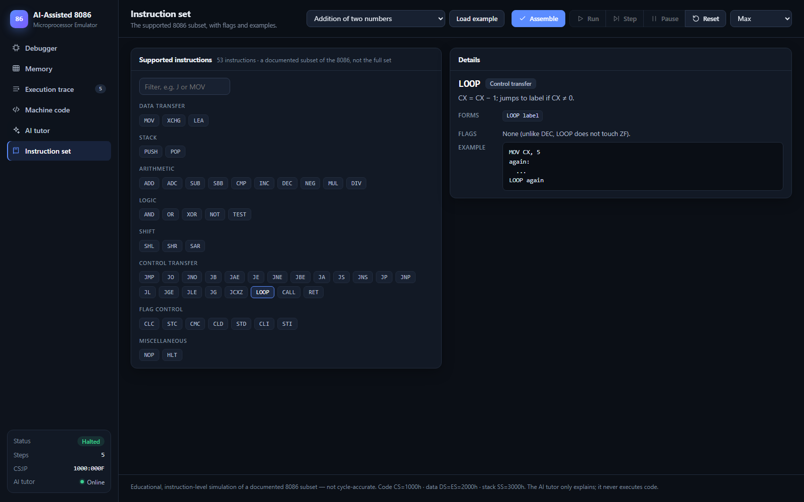
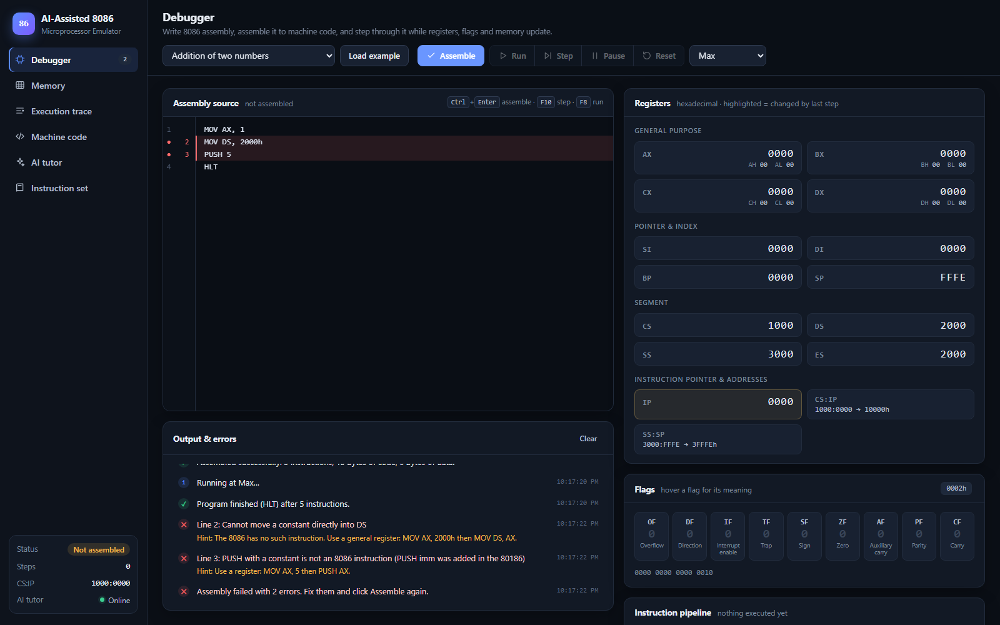
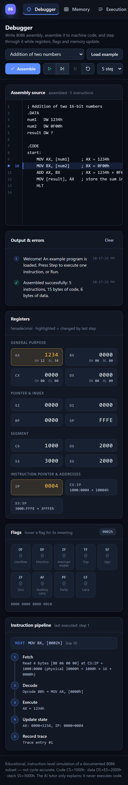
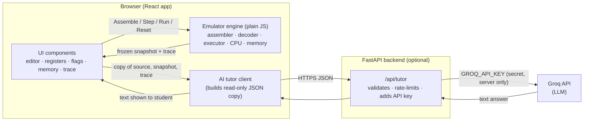

# AI-Assisted 8086 Microprocessor Emulator

A browser-based, educational emulator for the Intel 8086 microprocessor. Students write 8086 assembly,
assemble it into **real 8086 machine code**, and execute it **one instruction at a time** while watching the
registers, flags, memory, stack and an execution trace change. An **optional AI tutor** (Groq, through a small
FastAPI backend) explains what is happening. The tutor can only explain; it never runs code or changes anything.



| | |
|---|---|
| **Frontend** | React 19 + Vite. The emulator engine is plain JavaScript and runs entirely in the browser |
| **Backend (optional)** | Python FastAPI. It only relays AI tutor requests to Groq so the API key stays secret |
| **AI** | Groq chat completions API (default model `llama-3.3-70b-versatile`) |
| **Tests** | 232 frontend tests (Vitest) + 25 backend tests (pytest), all passing |
| **Hosting** | Render: Static Site (frontend) + Web Service (backend) |

---

## Contents

1. [The project in two minutes](#1-the-project-in-two-minutes)
2. [Features](#2-features)
3. [Screenshots](#3-screenshots)
4. [How it works](#4-how-it-works)
5. [The memory model](#5-the-memory-model)
6. [Flags, explained](#6-flags-explained)
7. [The AI tutor and why it cannot change anything](#7-the-ai-tutor-and-why-it-cannot-change-anything)
8. [Supported instructions](#8-supported-instructions)
9. [Assembly syntax accepted](#9-assembly-syntax-accepted)
10. [Example programs (verified)](#10-example-programs-verified)
11. [Known limitations](#11-known-limitations)
12. [Project structure](#12-project-structure)
13. [Setup on Windows (step by step)](#13-setup-on-windows-step-by-step)
14. [Testing](#14-testing)
15. [GitHub](#15-github)
16. [Deploying on Render](#16-deploying-on-render)
17. [Troubleshooting](#17-troubleshooting)
18. [Questions you may be asked (viva / demo)](#18-questions-you-may-be-asked-viva--demo)
19. [Glossary](#19-glossary)

---

## 1. The project in two minutes

**The problem.** The 8086 is the classic processor for learning computer architecture, but its behaviour is
invisible: you can't watch a register change or a flag flip inside a real chip. Students memorise rules
like "CMP sets ZF when the values are equal" without seeing them happen.

**What this project does.** It is a working 8086 that you can watch.

1. You type an assembly program (or load one of nine examples).
2. **Assemble** turns it into the same bytes a real 8086 would execute. `ADD AX, BX` becomes `01 D8`.
3. **Step** runs one instruction through a five-stage pipeline: **fetch → decode → execute → update → record**.
   Every register, flag and memory byte that changed is highlighted, and the step is written to a trace.
4. **Run** keeps stepping at the speed you choose until the program reaches `HLT`.
5. If you are confused, the **AI tutor** can explain the current line, the register values, the trace or your
   errors. It gets a read-only copy of the state, so it can explain but never change it.

**Why it is trustworthy.** Results come from a deterministic emulator engine covered by 232 automated tests,
not from the AI. The AI is optional: with no internet connection and no API key, everything except the tutor
still works.

**What it is not.** It is not a complete 8086. It implements a clearly documented subset (53 instructions plus
aliases such as JZ and SAL). It is not cycle-accurate: it simulates instruction by instruction, not clock tick by clock tick.

---

## 2. Features

- **Code editor** with line numbers, highlighting of the next instruction, error-line markers and Tab indentation.
- **Real two-pass assembler** with labels, `.DATA`/`.CODE` sections, `DB`/`DW` variables, `DUP`, strings,
  `EQU` constants, `OFFSET`, `BYTE PTR`/`WORD PTR`, segment overrides (`ES:[BX]`) and all 8086 addressing modes.
- **Helpful error messages** with line numbers and fix hints. For example, `MOV DS, 2000h` produces
  *"Cannot move a constant directly into DS. Use a general register: MOV AX, 2000h then MOV DS, AX."*
- **Controls:** Load example, Assemble, Run, Step, Pause, Reset, and speed (1–25 steps/s or Max).
  Shortcuts: `Ctrl+Enter` assemble, `F10` step, `F8` run/pause.
- **Registers panel:** AX, BX, CX, DX (with their high and low halves AH/AL and so on), SI, DI, BP, SP,
  CS, DS, SS, ES, IP and FLAGS in hexadecimal, plus the CS:IP and SS:SP physical addresses.
- **Flags panel:** one indicator per flag (OF DF IF TF SF ZF AF PF CF), with an explanation on hover.
- **Pipeline panel:** the five stages of the last executed instruction, in words.
- **Memory viewer:** any segment:offset in hex with ASCII, quick jumps to DS:0000, SS:SP and CS:IP, and
  highlighting of changed bytes.
- **Variables and Stack panels.**
- **Execution trace:** every step with address, machine code, instruction, what happened and every change.
- **Machine code listing:** the bytes for every source line, plus the label addresses.
- **Instruction set reference** that works offline, and **built-in help** for the line under the cursor (no AI needed).
- **Optional AI tutor:** explain the selected line, explain registers and flags, explain the trace, diagnose
  errors, or ask any question.
- **Safety:** bounds-checked memory, protected program code, stack overflow/underflow detection, a step limit
  that stops infinite loops, and **atomic instructions** (an instruction that fails is fully rolled back).
- **Responsive design:** the sidebar becomes a tab strip on phones.
- **Standalone file:** `standalone/index.html` is the whole emulator in one HTML file that runs offline.

---

## 3. Screenshots

| Debugger | Memory |
|---|---|
|  |  |
| **Execution trace** | **Machine code** |
|  |  |
| **AI tutor** | **Instruction set** |
|  |  |
| **Error messages** | **Phone** |
|  |  |

> The AI tutor screenshot was taken with a **local mock** of the Groq API (for testing without a key),
> so its answer text is a test message, not a real AI explanation.
>
> **To capture your own screenshots:** run the app (section 13), open http://localhost:5173, and press
> `Win + Shift + S` (Windows Snipping Tool). Save the images in `docs/screenshots/` with the same file names.

---

## 4. How it works

### 4.1 Architecture



Three rules keep the design clean:

1. **The engine has no UI code.** `frontend/src/emulator/` is plain JavaScript with no React and no browser
   APIs. It runs the same way in the browser, in Node.js tests and in the example-report script.
2. **Only the engine changes emulator state.** The UI calls `assemble()`, `step()`, `run()` and `reset()`.
   Everything the engine hands out (snapshots, trace entries) is a **deep-frozen copy**.
3. **The AI is on the far side of a one-way wall.** The tutor client never imports the engine. It receives
   JSON copies and returns text.

### 4.2 From source text to machine code: the assembler

`frontend/src/emulator/assembler.js` is a **two-pass assembler**:

| Pass | What happens |
|---|---|
| **Pass 1** | Reads every line. Handles `.DATA`/`.CODE`, records labels (`loop:`), lays out variables (`num DW 5`) in the data segment, evaluates `EQU` constants and checks the mnemonic is supported. |
| **Pass 2** | Parses operands (registers, numbers, `[BX+SI+4]`, variables, `BYTE PTR`, `ES:` …), checks them against 8086 rules, and **encodes** each instruction into bytes (opcode, ModR/M byte, displacement, immediate). |
| **Layout** | Gives every instruction an address. A `JMP` starts as a 2-byte short jump; if its target is more than 127 bytes away it is widened to a 3-byte near jump, and addresses are recomputed until nothing changes. Jump displacements are then filled in. |

Pass 2 needs a two-pass design because a label can be used before it is defined (`JMP done` … `done:`).
All errors are collected, each with its line number and a hint, rather than stopping at the first one.

The encoding follows Intel's 8086 opcode tables. The tests check 43 encodings against known machine code, for
example `MOV AX,1234h` → `B8 34 12`, `MOV [BX+SI+4],AL` → `88 40 04`, `ADD AX,5` → `83 C0 05`,
`MOV AX,ES:[BX]` → `26 8B 07`. Each encoding is also decoded back and re-assembled to the same bytes.

### 4.3 The instruction pipeline (what one *Step* does)

`frontend/src/emulator/emulator.js` → `step()`:

| # | Stage | What the code does | Example (`ADD AX, BX`) |
|---|---|---|---|
| 1 | **Fetch** | Reads instruction bytes from memory at **CS:IP** (physical = CS×16 + IP). | Read `01 D8` at 1000:0008 = physical 10008h |
| 2 | **Decode** | `decoder.js` turns the bytes into an instruction: opcode, ModR/M, operands. | Opcode 01h → `ADD AX, BX` |
| 3 | **Execute** | IP is moved past the instruction (as on a real 8086), then `executor.js` performs the operation through the ALU and computes the flags. | AX ← 1234h + 0F00h = 2134h |
| 4 | **Update** | Compares the CPU before and after and collects the memory writes, giving the list of changes. | AX: 1234→2134, IP: 0008→000A |
| 5 | **Record** | Appends a frozen entry to the execution trace. | Trace entry #3 |

**Atomic steps.** Before executing, the CPU registers are saved and memory writes are logged. If anything
fails (bad address, divide by zero, stack underflow…), the registers are restored and the writes are undone,
so a failed instruction never leaves half-changed state. The error is reported with its line number and a hint.

> This is an **instruction-level** simulation: each Step executes a whole instruction. It does not model
> clock cycles, the bus interface unit, the prefetch queue or timing. It is **not cycle-accurate**.

### 4.4 Main source files

| File | Responsibility |
|---|---|
| `emulator/constants.js` | Register names, default segments, flag bit positions |
| `emulator/cpu.js` | Register file: 8/16-bit registers (AL is the low half of AX), segment registers, IP, FLAGS |
| `emulator/memory.js` | 1 MB byte array with bounds checking, code protection and a write log for rollback |
| `emulator/alu.js` | Arithmetic and logic results plus CF, PF, AF, ZF, SF, OF |
| `emulator/assembler.js` | Source text → machine code, with error messages |
| `emulator/decoder.js` | Machine code → instruction object, and disassembly text |
| `emulator/executor.js` | Semantics of each instruction |
| `emulator/emulator.js` | Pipeline, step/run/reset, trace, frozen snapshots |
| `emulator/isa.js` | Documentation and opcode tables for the supported subset (single source of truth) |
| `ai/tutorClient.js` | Builds the read-only tutor request and calls the backend |
| `backend/app/main.py` | FastAPI app: `/api/health`, `/api/tutor`, CORS, rate limit |
| `backend/app/prompts.py` | System prompt with the tutor's rules, plus the context message |
| `backend/app/groq_client.py` | Calls Groq, turns failures into clear error messages |

---

## 5. The memory model

The 8086 has a **20-bit address bus**, so it can address **1 MB** (00000h–FFFFFh). Registers are only 16 bits,
so a full address is built from two parts:

```
physical address = segment × 16 + offset          e.g. 2000h:0010h → 20000h + 0010h = 20010h
```

When a program is loaded, this emulator places it as follows:

| Area | Segment register | Starts at | Physical | Contents |
|---|---|---|---|---|
| Code | CS = **1000h** | IP = 0000h | 10000h | Machine code from `.CODE` |
| Data | DS = **2000h** (ES = 2000h too) | offset 0000h | 20000h | Variables from `.DATA`, in order |
| Stack | SS = **3000h** | SP = **FFFEh** | 3FFFEh | Grows downward: PUSH does SP−2, then writes |

- Words are **little-endian**: `DW 1234h` is stored as `34 12`.
- `[BP…]` addresses use **SS** by default and all others use **DS**, exactly as on the 8086. A prefix such as
  `ES:[BX]` overrides this.
- Effective addresses wrap at 64 KB inside a segment (`BX=FFFFh`, `[BX+1]` → offset 0000h), as on the 8086.

**Protections.** These are deliberate safety additions; a real 8086 would silently do something else:

| Situation | Real 8086 | This emulator |
|---|---|---|
| Physical address above FFFFFh | wraps to 0 | stops with an error |
| Word access at offset FFFFh | wraps inside the segment | stops with an error |
| Writing over the loaded program code | allowed (self-modifying code) | blocked, with an error |
| POP or RET with an empty stack | reads garbage | "stack underflow" error |
| Running past the last instruction | executes whatever bytes follow | "IP outside the program — did you forget HLT?" |
| An infinite loop | runs forever | stops after 100,000 instructions |
| Division by zero / quotient too large | interrupt 0 | stops with a "divide error" |

---

## 6. Flags, explained

| Flag | Name | Set to 1 when… |
|---|---|---|
| **CF** | Carry | an **unsigned** result needed a carry out (ADD) or a borrow (SUB/CMP) |
| **ZF** | Zero | the result is zero |
| **SF** | Sign | the top bit of the result is 1 (negative as a signed number) |
| **OF** | Overflow | a **signed** result does not fit (e.g. 127 + 1 in 8 bits) |
| **PF** | Parity | the low byte of the result has an even number of 1 bits |
| **AF** | Auxiliary carry | there was a carry/borrow between bit 3 and bit 4 (used by BCD arithmetic) |
| **DF, IF, TF** | Direction, Interrupt, Trap | control flags, changed only by CLD/STD and CLI/STI here |

**CF vs OF** is the classic confusion. In 8-bit arithmetic:
- `0FFh + 1` = 00h → **CF = 1** (255 + 1 overflowed as an unsigned number) but OF = 0 (−1 + 1 = 0 is fine as signed).
- `7Fh + 1` = 80h → **OF = 1** (127 + 1 = 128 does not fit in signed 8-bit) but CF = 0.

Choose the jump to match: **JA/JB** for unsigned comparisons (they use CF), **JG/JL** for signed ones
(they use SF and OF).

Where Intel calls a flag "undefined" after an instruction, the emulator documents exactly what it does:
AND/OR/XOR/TEST **clear AF**; MUL and DIV leave SF, ZF, AF and PF **unchanged**; shifts leave AF unchanged, and
leave OF unchanged when the count is more than 1. FLAGS bit 1 always reads 1 (so the initial value is 0002h).

---

## 7. The AI tutor and why it cannot change anything

**What it can do:** explain the selected line, explain the current registers and flags, walk through the
trace, diagnose assembler or runtime errors with suggested fixes, and answer free-form 8086 questions.

**How a request travels:**

1. You click a tutor button. `tutorClient.js` builds a **plain JSON copy** of the source, the selected line,
   the frozen snapshot, the last 20 trace entries, the errors and the supported-instruction list.
2. The browser POSTs it to **your** backend at `/api/tutor`. **The browser never sees the API key.**
3. The backend validates the size of every field, applies a per-visitor rate limit, builds the prompt and
   adds `GROQ_API_KEY` from an environment variable.
4. Groq returns text. The backend returns `{answer, model, disclaimer}`.
5. The UI shows the text. Code in the answer is displayed as text and never run.

**Why it cannot modify the emulator** (each point is checked by a test):

- `tutorClient.js` does not import the engine.
- Snapshots are deep-frozen. The request is a JSON copy, so even a tampered response cannot reach the engine.
- The answer is rendered as text with a small safe renderer (no `innerHTML`).
- The backend has only three routes: `GET /`, `GET /api/health`, `POST /api/tutor`. None can run code.
- The system prompt states that the emulator is the only source of truth, that the AI cannot execute
  anything, and that it must not invent values.

**Honest failure:** if the key is missing, Groq is unreachable, the quota is used up or the answer is empty,
the UI shows a clear message ("The AI tutor is not configured on the server…"). It never shows a fake answer.

**No-AI mode:** without a backend or key, the sidebar shows *AI tutor: Offline*. Everything else works,
including the offline instruction reference and the built-in help for the selected line.

---

## 8. Supported instructions

This is a **documented subset** of the 8086, not the complete instruction set. Every instruction below is
assembled to real 8086 machine code and executed by the emulator.

| Group | Instructions |
|---|---|
| Data transfer | `MOV`, `XCHG`, `LEA` |
| Stack | `PUSH`, `POP` (16-bit registers, segment registers, memory) |
| Arithmetic | `ADD`, `ADC`, `SUB`, `SBB`, `CMP`, `INC`, `DEC`, `NEG`, `MUL` (unsigned), `DIV` (unsigned) |
| Logic | `AND`, `OR`, `XOR`, `NOT`, `TEST` |
| Shift | `SHL` (= `SAL`), `SHR`, `SAR`, by `1` or `CL` |
| Unconditional jumps & calls | `JMP` (short or near, chosen automatically), `CALL`, `RET` |
| Conditional jumps | `JE/JZ`, `JNE/JNZ`, `JA/JNBE`, `JAE/JNB/JNC`, `JB/JNAE/JC`, `JBE/JNA`, `JG/JNLE`, `JGE/JNL`, `JL/JNGE`, `JLE/JNG`, `JS`, `JNS`, `JO`, `JNO`, `JP/JPE`, `JNP/JPO`, `JCXZ` |
| Loops | `LOOP` |
| Flag control | `CLC`, `STC`, `CMC`, `CLD`, `STD`, `CLI`, `STI` |
| Other | `NOP`, `HLT` |

**Registers:** AX BX CX DX (with AH AL BH BL CH CL DH DL), SI DI BP SP, CS DS SS ES, IP, FLAGS.
**Addressing modes:** register, immediate, direct `[1234h]` or `var`, register-indirect `[BX]`, based
`[BX+4]` / `[BP+2]`, indexed `[SI+2]` / `arr[SI]`, based-indexed `[BX+SI+4]`, and segment override `ES:[BX]`.

**Recognised but not supported** (they give a clear error): `IMUL`, `IDIV`, `INT`, `IRET`, `IN`, `OUT`,
string instructions (`MOVSB`, `LODSB`, `STOSB`, `CMPSB`, `SCASB` and the word forms), `REP` prefixes,
`LOOPE`/`LOOPNE`, `ROL`/`ROR`/`RCL`/`RCR`, `PUSHF`/`POPF`, `LAHF`/`SAHF`, `CBW`/`CWD`, BCD adjust
(`AAA`, `DAA`…), `LDS`/`LES`, `XLAT`, far `JMP`/`CALL`/`RETF`, `LOCK`, `WAIT`, `ESC`.
**80186+ instructions** such as `PUSHA`, `ENTER`, `PUSH imm` and `SHL AX, 3` are rejected with an explanation
that they do not exist on the 8086.

The **Instruction set** view in the app shows the syntax, flags affected, notes and an example for each one.

---

## 9. Assembly syntax accepted

```asm
; comments start with a semicolon
COUNT EQU 5                 ; constant

.DATA                       ; variables (placed at DS:0000 onward)
num     DW 1234h            ; word
small   DB 7                ; byte
msg     DB 'Hi', 0          ; string + terminator
buffer  DB 4 DUP(0)         ; 4 zero bytes
result  DW ?                ; uninitialised (0)

.CODE
start:                      ; label
    MOV AX, [num]           ; or MOV AX, num (MASM style)
    MOV SI, OFFSET buffer   ; address of a variable
    MOV BYTE PTR [SI], 'A'  ; size needed when no register says it
    MOV CX, COUNT
again:
    INC WORD PTR [result]
    LOOP again
    HLT                     ; every program should end with HLT
```

- Numbers: `25`, `25d`, `19h`, `0FFh` (hex numbers must start with a digit), `0x1F`, `1010b`, `'A'`, `-1`.
  Expressions with `+` and `-` are allowed: `[arr+2]`, `10h+2`.
- Case-insensitive. `.MODEL` and `.STACK` are accepted and ignored. `name PROC` / `name ENDP` and `END` work.
- `ORG` is not supported (code always starts at CS:0000h).

---

## 10. Example programs (verified)

Choose an example in the toolbar and click **Load example**. The table shows the final values after running
to `HLT`. These were **produced by the emulator**: `npm run examples` writes the full report, with every
program's source and complete execution trace, to **[docs/EXAMPLES.md](docs/EXAMPLES.md)**. The same values
are asserted by `frontend/tests/examples.test.js`.

| Example | Steps | Key final values | Flags at the end |
|---|---|---|---|
| Addition of two numbers | 5 | AX=2134h, BX=0F00h, `result`=2134h | all 0 |
| Subtraction of two numbers | 6 | AX=FFDBh (50h−75h, borrow), CX=0000h, `diff`=FFDBh | ZF=1 PF=1 |
| Increment and decrement | 8 | AX=0000h, BX=FFFFh (CF stayed 1 after INC/DEC) | CF=1 SF=1 AF=1 PF=1 |
| Comparison and conditional jumps | 12 | AX=0028h (max of 25, 40), DX=0001h, `max`=0028h | ZF=1 PF=1 |
| Simple loop (sum 1..5) | 25 | AX=BX=000Fh (15), CX=0000h, SI=0003h | ZF=1 PF=1 |
| Register and memory operations | 29 | AX=3344h, SI=0004h, DI=0008h, DX=0004h; `dst` = 11 22 EF BE | all 0 |
| Flags: carry, overflow and sign | 7 | AL=00h, BL=80h, CX=FFFFh | CF=1 SF=1 AF=1 PF=1 |
| Stack, CALL and RET | 11 | AX=2222h, BX=1111h (swapped), CX=000Eh, SP=FFFEh | all 0 |
| Multiply, divide and shift | 12 | AX=008Eh (1000÷7=142), DX=0006h, BX=0010h | all 0 |

Example: the trace of *Addition of two numbers*, copied from the generated report:

| # | CS:IP | Bytes | Instruction | What happened | Changes |
|---|---|---|---|---|---|
| 1 | 1000:0000 | `8B 06 00 00` | `MOV AX, [0000h]` | AX ← 1234h | AX: 0000→1234, IP: 0000→0004 |
| 2 | 1000:0004 | `8B 1E 02 00` | `MOV BX, [0002h]` | BX ← 0F00h | BX: 0000→0F00, IP: 0004→0008 |
| 3 | 1000:0008 | `01 D8` | `ADD AX, BX` | AX ← 1234h + 0F00h = 2134h | AX: 1234→2134, IP: 0008→000A |
| 4 | 1000:000A | `89 06 04 00` | `MOV [0004h], AX` | [0004h] ← 2134h | IP: 000A→000E, [20004]: 00→34, [20005]: 00→21 |
| 5 | 1000:000E | `F4` | `HLT` | processor halted | IP: 000E→000F |

---

## 11. Known limitations

- **Subset only** (section 8). There are no interrupts, I/O ports, string instructions, signed multiply/divide or rotates.
- **Not cycle-accurate.** No clock cycles, bus cycles, prefetch queue or timing.
- **No far control transfer.** CS never changes, and programs are limited to one 64 KB code segment.
- **Fixed memory layout** (CS=1000h, DS=ES=2000h, SS=3000h, SP=FFFEh). There is no `ORG`.
- **Deliberate safety checks** differ from real hardware (section 5): out-of-range addresses, writes to
  code, stack underflow and running past the end stop with an error instead of continuing.
- **Undefined flags** use a documented, consistent choice (section 6) that may differ from a real chip.
- **Output:** there is no screen or `INT 21h`. Results appear in registers, memory and the trace.
- **The AI tutor** can be wrong, needs a backend plus a Groq key, and is subject to Groq's free-tier limits.
  Its answers are never used as execution results.
- **Free hosting:** a Render free web service sleeps when idle, so the first tutor request after a while can take about a minute.

---

## 12. Project structure

```
ai-assisted-8086-emulator/
├── frontend/                     React app + emulator engine
│   ├── index.html
│   ├── package.json              scripts: dev, build, build:standalone, test, examples
│   ├── vite.config.js            dev proxy /api → :8000, test config, standalone build
│   ├── .env.example              VITE_API_BASE_URL (public, not secret)
│   ├── src/
│   │   ├── emulator/             ★ engine: no React, no browser APIs
│   │   │   ├── assembler.js  decoder.js  executor.js  alu.js
│   │   │   ├── cpu.js  memory.js  emulator.js  isa.js
│   │   │   └── constants.js  format.js  index.js
│   │   ├── ai/tutorClient.js     ★ AI client: never imports the engine
│   │   ├── examples/programs.js  the 9 examples + expected results
│   │   ├── components/           Sidebar, Toolbar, CodeEditor, RegisterPanel, FlagsPanel,
│   │   │                         PipelinePanel, MemoryViewer, DataPanels, TracePanels,
│   │   │                         ConsolePanel, TutorPanel, ReferencePanel, Card, Icons
│   │   ├── App.jsx  main.jsx  styles.css
│   ├── tests/                    Vitest: engine, examples, tutor separation, UI
│   └── scripts/run-examples.mjs  generates docs/EXAMPLES.md
├── backend/                      optional FastAPI AI tutor proxy
│   ├── app/  main.py  config.py  schemas.py  prompts.py  groq_client.py
│   ├── tests/test_api.py         pytest (Groq is mocked)
│   ├── requirements.txt  requirements-dev.txt  pytest.ini
│   └── .env.example              GROQ_API_KEY placeholder, model, CORS origins
├── standalone/index.html         whole emulator in one file (offline, no AI)
├── docs/EXAMPLES.md              generated example report with traces
├── docs/screenshots/
├── render.yaml                   Render blueprint (both services)
├── .gitignore
└── README.md
```

**Which features need the backend?** Only the **AI tutor**. The emulator, examples, traces, memory viewer,
instruction reference and built-in help all run in the browser alone.

---

## 13. Setup on Windows (step by step)

### 13.1 Install the tools (once)

| Tool | Version | Download | Check in PowerShell |
|---|---|---|---|
| Node.js (LTS) | 20 or newer | https://nodejs.org | `node -v` |
| Python | 3.10 or newer | https://www.python.org/downloads/ (tick **"Add python.exe to PATH"**) | `python --version` |
| Git | any | https://git-scm.com/download/win | `git --version` |

Open **PowerShell** and go to the project folder (adjust the path):

```powershell
cd C:\Users\USER\Downloads\ai_emulator
```

### 13.2 Run the emulator only (no AI, simplest)

```powershell
cd frontend
npm install
npm run dev
```

Open **http://localhost:5173**. You should see the Debugger with the *Addition* example already assembled.
Press **Step**. The sidebar will say *AI tutor: Offline*, which is expected.
Stop the server with `Ctrl + C`.

> **No install at all:** double-click `standalone\index.html`. It is the complete emulator in one file
> (rebuild it with `npm run build:standalone`).

### 13.3 Add the AI tutor (backend + Groq)

1. Get a free API key: sign in at **https://console.groq.com**, open **API Keys**, click **Create API Key** and copy it.
2. Open a **second** PowerShell window:

```powershell
cd C:\Users\USER\Downloads\ai_emulator\backend
python -m venv .venv
.\.venv\Scripts\Activate.ps1
pip install -r requirements-dev.txt
Copy-Item .env.example .env
notepad .env
```

3. In Notepad, replace `your_groq_api_key_here` with your key, then save and close.
4. Start the backend:

```powershell
uvicorn app.main:app --reload --port 8000
```

Expected output: `Uvicorn running on http://127.0.0.1:8000`. Check http://localhost:8000/api/health. It should show
`{"status":"ok","ai_configured":true,"provider":"groq","model":"llama-3.3-70b-versatile"}`.

5. Keep the frontend running (`npm run dev` in the first window) and reload http://localhost:5173.
   The sidebar shows *AI tutor: Online*. Open **AI tutor** and click **Explain registers & flags**.

> If `Activate.ps1` is blocked with *"running scripts is disabled on this system"*, run this once:
> `Set-ExecutionPolicy -Scope CurrentUser RemoteSigned` and answer `Y`.

---

## 14. Testing

### 14.1 Run the tests

```powershell
# frontend: engine, examples, AI separation, UI integration
cd C:\Users\USER\Downloads\ai_emulator\frontend
npm test

# backend: API, validation, CORS, rate limit, Groq client (Groq is mocked)
cd ..\backend
.\.venv\Scripts\Activate.ps1
pytest -q
```

Expected: `Tests  232 passed (232)` and `25 passed`.

### 14.2 What is tested

| Area | File | What is checked |
|---|---|---|
| Register reads/writes | `registers.test.js` | AL/AH aliasing of AX, width truncation, reset values, MOV/XCHG |
| Arithmetic & flags | `arithmetic.test.js` | ADD/ADC/SUB/SBB/CMP/NEG/INC/DEC flags incl. carry vs overflow, MUL/DIV, divide errors, logic, shifts, flag instructions |
| Comparisons & jumps | `control.test.js` | all 16 conditions (signed/unsigned), JCXZ, LOOP, CALL/RET, IP after each instruction, short/near JMP, out-of-range errors |
| Memory & addresses | `memory.test.js` | segment×16+offset, little-endian, all addressing modes, BP→SS, overrides, 64 KB wrap, 1 MB bounds, code protection, rollback, stack |
| Assembler | `assembler.test.js` | 43 encodings vs. real machine code + decode round-trip, number formats, 28 invalid-code cases with hints |
| Step / run / reset | `emulator.test.js` | pipeline trace entry, run to HLT, run(limit), reset, missing HLT, infinite-loop limit, frozen snapshots |
| Examples | `examples.test.js` | each example's documented registers, flags, variables and memory |
| AI separation | `tutor.test.js` | client doesn't import the engine; request is a copy; a tampering transport can't change state; error handling; no fabricated answers |
| Frontend UI | `app.test.jsx` | renders, Step/Run/Pause/Reset, editing marks dirty, error display, flags, sidebar navigation, tutor disabled/enabled, request contains snapshot |
| Backend | `backend/tests/test_api.py` | health, 503 without key, answer pass-through, prompt rules, error mapping (401/404/429/500/timeout/network), validation limits, CORS, rate limit, only 3 routes |

### 14.3 Checked manually (not automated)

These were checked by driving the real app in Chrome with a browser-automation script (stepping, running,
every view, and the AI tutor through the real FastAPI backend pointed at a **local mock Groq server**), with
no browser console errors. Layout was checked at 1600 px, 820 px and 390 px wide with no horizontal scrolling.

**Not verified here** (you must check these yourself):
- A real Groq API call with your key (section 13.3, step 5).
- The deployed Render URLs (section 16).
- Browsers other than Chrome (Firefox, Safari).

---

## 15. GitHub

### 15.1 First upload

Create an **empty** repository on GitHub named **`ai-assisted-8086-emulator`** (no README, no .gitignore).
Then, in PowerShell:

```powershell
cd C:\Users\USER\Downloads\ai_emulator

git init                                  # skip if the folder is already a git repository
git config user.name  "Your Name"
git config user.email "you@example.com"

git add .
git status                                # check: NO .env, node_modules or .venv in the list
git commit -m "AI-assisted 8086 emulator: React frontend, FastAPI tutor backend, tests"

git branch -M main
git remote add origin https://github.com/YOUR-USERNAME/ai-assisted-8086-emulator.git
git push -u origin main
```

When asked to log in, use the browser window that opens (Git Credential Manager).

> **If you already made a commit before this `.gitignore` existed**, compiled files may be tracked. Remove
> them from git (your local copies are kept), then commit:
> ```powershell
> git rm -r --cached backend/app/__pycache__ frontend/dist
> git add .
> git commit -m "Stop tracking build output; add tests and docs"
> ```

### 15.2 Later changes

```powershell
git add .
git commit -m "Describe your change"
git push
```

### 15.3 Never commit secrets

- `backend/.env` holds your real key. It is in `.gitignore`. Only `.env.example` (placeholders) is committed.
- Before every commit, `git status` must not list `.env`.
- If a key is ever pushed, **revoke it immediately** at console.groq.com and create a new one. Deleting the file
  afterward is not enough, because it stays in git history.

---

## 16. Deploying on Render

You will create two services from the same GitHub repository:

| Service | Render type | Root directory | Build command | Start / publish |
|---|---|---|---|---|
| **Backend** (AI tutor) | Web Service (Python), free | `backend` | `pip install -r requirements.txt` | `uvicorn app.main:app --host 0.0.0.0 --port $PORT` |
| **Frontend** (emulator) | Static Site | `frontend` | `npm ci && npm run build` | Publish directory `dist` |

### 16.1 Deploy the backend first

1. Sign in at **https://render.com** with GitHub.
2. Click **New → Web Service**, connect your GitHub account and pick `ai-assisted-8086-emulator`.
3. Settings:
   - **Name:** `ai-8086-tutor-api` · **Root Directory:** `backend` · **Runtime:** Python 3
   - **Build Command:** `pip install -r requirements.txt`
   - **Start Command:** `uvicorn app.main:app --host 0.0.0.0 --port $PORT`
   - **Instance type:** Free
4. **Environment variables:**

   | Key | Value |
   |---|---|
   | `GROQ_API_KEY` | your Groq key |
   | `GROQ_MODEL` | `llama-3.3-70b-versatile` |
   | `PYTHON_VERSION` | `3.11.9` |
   | `ALLOWED_ORIGINS` | leave blank for now; fill it in at step 16.3 |

5. Click **Create Web Service**. When it finishes, open `https://ai-8086-tutor-api.onrender.com/api/health`
   (your URL may differ). It should show `"ai_configured": true`.

### 16.2 Deploy the frontend

1. **New → Static Site**, and pick the same repository.
2. **Root Directory:** `frontend` · **Build Command:** `npm ci && npm run build` · **Publish Directory:** `dist`
3. **Environment variable:** `VITE_API_BASE_URL` = your backend URL from 16.1, e.g.
   `https://ai-8086-tutor-api.onrender.com` (**no trailing slash**).
4. Click **Create Static Site**. Your app will be at something like `https://ai-8086-emulator.onrender.com`.

`VITE_API_BASE_URL` is built into the JavaScript at build time. If you change it, use
**Manual Deploy → Clear build cache & deploy**.

### 16.3 Connect them (CORS)

The browser only lets the frontend call the backend if the backend allows the frontend's address.
In the **backend** service → **Environment**, set:

```
ALLOWED_ORIGINS = https://ai-8086-emulator.onrender.com
```

Use your exact static-site URL with no trailing slash, and separate several origins with commas. Save; the
backend redeploys automatically.

### 16.4 Verify the deployment

1. Open the static-site URL. Load an example, then Step and Run. This proves the emulator works.
2. The sidebar should say *AI tutor: Online*. Open **AI tutor** and click **Explain registers & flags**.
3. If the tutor is offline, see section 17.

**Alternative:** **New → Blueprint** reads `render.yaml` and creates both services. It will ask for the
`sync: false` values (`GROQ_API_KEY`, `ALLOWED_ORIGINS`, `VITE_API_BASE_URL`).

> **Free tiers change.** Render's free web services sleep after about 15 minutes idle (the first request
> then takes 30–60 s), and Groq's free tier has rate and daily limits. Neither is unlimited, and both providers
> can change their terms. The emulator (a static site) is unaffected by either.

> **Deployment status:** this project has **not** been deployed from this workspace. The steps above are
> instructions; test your own URLs as described in 16.4.

---

## 17. Troubleshooting

| Problem | Cause | Fix |
|---|---|---|
| `npm` or `node` is not recognized | Node not installed or PATH not refreshed | Install Node LTS, then **close and reopen** PowerShell |
| `python` opens the Microsoft Store | Store alias | Install from python.org with "Add to PATH"; or Settings → Apps → *App execution aliases* → turn off python |
| `Activate.ps1 cannot be loaded` | PowerShell execution policy | `Set-ExecutionPolicy -Scope CurrentUser RemoteSigned` |
| Port 5173 or 8000 already in use | Another server is running | Close the other window, or `npm run dev -- --port 5174` / `uvicorn ... --port 8001` (then change the proxy in `vite.config.js`) |
| Sidebar: *AI tutor: Offline* | Backend not running / wrong URL | Start the backend (13.3). Locally, leave `VITE_API_BASE_URL` empty |
| *"no GROQ_API_KEY is configured"* | `.env` missing or empty | Create `backend/.env` from `.env.example`, add your key, restart uvicorn |
| *"rejected the API key"* | Wrong or revoked key | Create a new key at console.groq.com |
| *"model … was not found"* | Model retired or renamed | Set `GROQ_MODEL` to a model listed in your Groq console |
| *"rate limit or free-tier quota"* (429) | Groq limits or the backend's own limit | Wait a minute; raise `RATE_LIMIT_PER_MINUTE` if needed |
| Deployed tutor fails; browser console shows **CORS** | `ALLOWED_ORIGINS` doesn't match | Set it to the exact static-site URL (https, no trailing slash) |
| Deployed tutor: 404 | `VITE_API_BASE_URL` wrong | Fix it and **Clear build cache & deploy** the static site |
| First tutor answer takes ~1 minute | Free backend was asleep | Normal on the free tier; later requests are fast |
| Render build: `npm ci` fails | `package-lock.json` missing | Commit `frontend/package-lock.json` |
| Render build: Python errors | Wrong root/version | Root Directory `backend`, `PYTHON_VERSION=3.11.9` |
| Program: *"IP … is outside the program"* | Missing `HLT` | End the program with `HLT` |
| Program: *"Operand size is ambiguous"* | `MOV [BX], 5` | Write `MOV BYTE PTR [BX], 5` or `WORD PTR` |
| Program: *"not a valid number"* for `FFh` | Hex must start with a digit | Write `0FFh` |
| Program: *"Step limit reached"* | Infinite loop | Make sure the loop counter changes and the condition can become false |

---

## 18. Questions you may be asked (viva / demo)

**Q: Is the AI doing the emulation?**
No. A deterministic JavaScript engine assembles and executes the code. The AI only receives a frozen copy of
the results and explains them. Tests prove the tutor client can't reach the engine.

**Q: Why is there a backend at all if the emulator runs in the browser?**
To keep the Groq API key secret. Any key in browser JavaScript can be read by every visitor. The backend holds
it in an environment variable and only forwards validated, size-limited, rate-limited requests.

**Q: How is the physical address calculated?**
`segment × 16 + offset`. For example DS=2000h, offset 0010h → 20010h. Multiplying by 16 is a shift left by 4
bits, which turns two 16-bit values into a 20-bit address, enough for 1 MB.

**Q: Why does `MOV DS, 2000h` fail?**
The 8086 has no instruction that loads a segment register with an immediate value. Load a general register
first: `MOV AX, 2000h` then `MOV DS, AX`.

**Q: What is the difference between CF and OF?**
CF reports unsigned overflow (carry or borrow out of the top bit). OF reports signed overflow (the sign of the
result is wrong). See section 6.

**Q: Why do INC/DEC not change CF?**
That is how the 8086 defines them. It lets a loop counter be updated inside multi-word arithmetic without
destroying the carry. The *Increment and decrement* example shows it.

**Q: How does `LOOP` work?**
It decrements CX and jumps if CX ≠ 0, without changing any flags.

**Q: What happens on `CALL` and `RET`?**
`CALL` pushes the address of the next instruction (SP decreases by 2) and jumps. `RET` pops that address into
IP. You can watch the stack in the Memory view.

**Q: Why is the machine code for `MOV AX, BX` `89 D8`?**
`89` means "MOV r/m16, reg16". The ModR/M byte `D8` = `11 011 000` means register mode, source BX (011) and
destination AX (000).

**Q: Is it cycle-accurate?**
No. It is instruction-level: each step runs a whole instruction. Cycle accuracy would need the bus interface
unit, the prefetch queue and per-instruction timing, which are out of scope.

**Q: How do you know the results are right?**
257 automated tests. They include encodings compared with real 8086 machine code, flag results for edge cases
such as 7Fh+1 and 0FFh+1, all 16 jump conditions, and every example's final state.

**Q: What happens if a student writes something invalid?**
The assembler reports every error with its line number and a hint. At runtime, the faulty instruction is fully
rolled back and execution stops with an explanation.

---

## 19. Glossary

| Term | Meaning |
|---|---|
| **Assembler** | Program that turns assembly text into machine code |
| **Opcode** | The byte(s) that identify an instruction (e.g. `F4` = HLT) |
| **ModR/M byte** | Byte after the opcode that encodes which registers/memory the instruction uses |
| **Register** | Small, fast storage inside the CPU (AX, BX, …) |
| **Segment / offset** | Two 16-bit parts of an 8086 address: physical = segment × 16 + offset |
| **IP** | Instruction Pointer: offset in CS of the next instruction |
| **SP / stack** | Stack pointer; the stack is a last-in-first-out area in SS used by PUSH/POP/CALL/RET |
| **Flags** | 1-bit results of the last operation (zero? negative? carry?) used by conditional jumps |
| **Little-endian** | Low byte stored at the lower address (`1234h` → `34 12`) |
| **Trace** | Recorded list of every executed instruction and its effects |
| **Snapshot** | A frozen copy of the CPU state at one moment |
| **CORS** | Browser rule that controls which websites may call an API |
| **Environment variable** | A setting given to a program by its host (used here to keep the API key out of the code) |

---

*Educational project. Intel 8086 behaviour is based on the Intel 8086 Family User's Manual. Not affiliated with Intel.*
